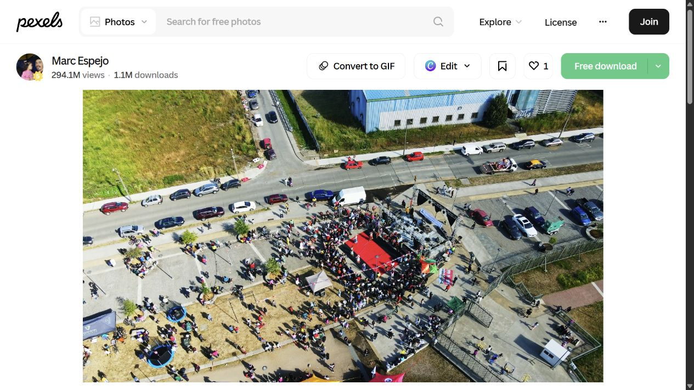
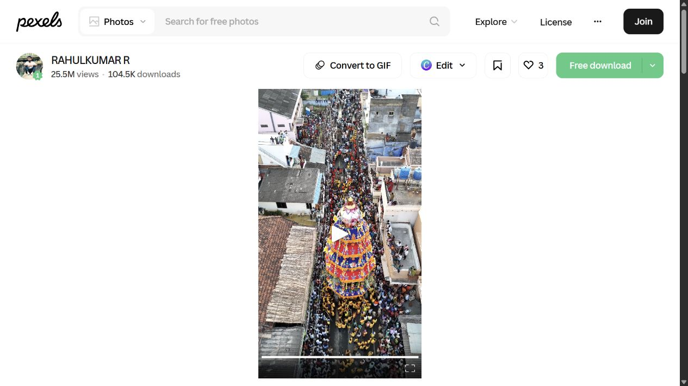

# Preliminary visual review of crowd videos

Reviewed 10 October 2026 using browser playback screenshots at separated moments. **8 of the 50 catalogue videos sampled**, plus 2 earlier sources. These are visual-fit assessments, not full video reviews, risk annotations or training approvals. Playback frequently buffered. No source video was downloaded.

## Results

| ID | Preliminary decision | What I actually observed |
| --- | --- | --- |
| V001 | Conditional challenge clip | Night overhead crowd with strong changing coloured illumination. Layout is visible, but light changes can create false optical-flow motion. Buffering limited inspection; camera stability not established. |
| V003 | Deprioritise primary training | Sampled night view is dominated by stage/arena structures. Spectators are dim and small. Poor primary crowd ROI; full clip might contain a better window but not established. |
| V004 | Conditional challenge clip | Ground-level indoor audience with raised phones, foreground backs/heads, low light and changing stage illumination. Heavy occlusion. Candidate for false-alarm/robustness testing rather than clean flow ground truth. |
| V007 | Deprioritise primary training | Overhead title is misleading for our purpose: sampled frames show a brightly lit stage occupying most of the image, with audience mainly along the lower border. Crop possibilities need full review. |
| V018 | Prioritise further review | Daylight elevated view of seated rows and people around perimeter paths. Useful candidate for crowded but non-running scene testing. Bench/chair geometry and camera drift require care; no danger label assigned. |
| V020 | Prioritise further review | Daylight overhead view shows a local cluster around a red event structure plus people in open areas and adjacent roads. Useful crowd-ROI and occupancy variation. Vehicles must be masked; drone-motion checks still required. |
| V028 | Conditional challenge clip | Stadium supporters viewed from within the stands. Foreground people are clear but obscure the wider crowd. Cheering and flags are visible. Useful hard-negative candidate only after window annotation; no escape/crush evidence established. |
| V046 | Prioritise further review | Elevated portrait view shows a procession along a narrow street around a decorated structure. Later sampled frames show substantial camera/framing change. Useful geometry/flow scenario; stabilise before motion features. Only about 9.86 seconds long. |

## Two earlier sources sampled

- [Large outdoor crowd, Pexels 17758188](https://www.pexels.com/video/a-large-crowd-of-people-gathered-in-front-of-a-stage-17758188/): one sampled daylight aerial frame shows a dense standing audience and perimeter circulation. Promising for layout/occupancy review, but one frame cannot establish flow or safety. This source is not in the 50-link catalogue. Earlier duration claims should not be relied upon until checked against actual media.
- [AP Argentina World Cup celebration](https://www.youtube.com/watch?v=QF5s5-ZS-JQ): sampled opening playback at approximately 6–10 seconds shows a wide elevated view around the Obelisk. Crowd scale is clear but individuals are very small and a foreground head appears briefly. Candidate for occupancy/false-alarm evaluation, not evidence of stampede onset. Copyright permission remains unresolved. This source is also outside the 50-link catalogue.

## Recommended order

1. Fully review V018, V020 and V046 for usable windows, original playback timing and camera motion.
2. Treat V001, V004 and V028 as difficult-scene candidates, not the clean initial training set.
3. Deprioritise V003 and V007 unless longer review finds crowd-facing windows.
4. Review the other 42 catalogue videos. Do not interpret unreviewed entries as accepted.
5. Clear training rights before acquiring or preprocessing any source footage. All training approvals remain false.

No sampled scene establishes a real stampede or pre-incident warning label. A narrow street, dense crowd, jumping or cheering must not automatically be labelled dangerous.

## Example sampled views

Daylight festival layout (V020):

Narrow-street procession (V046):

